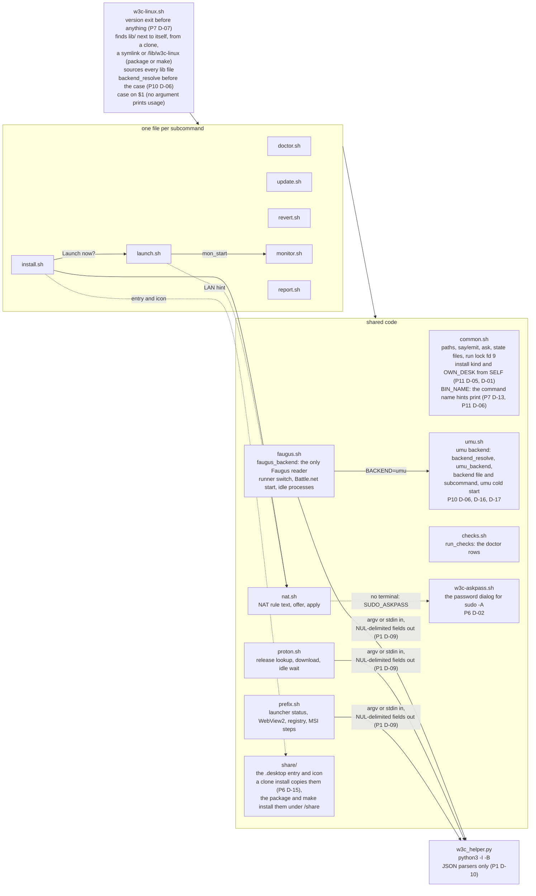
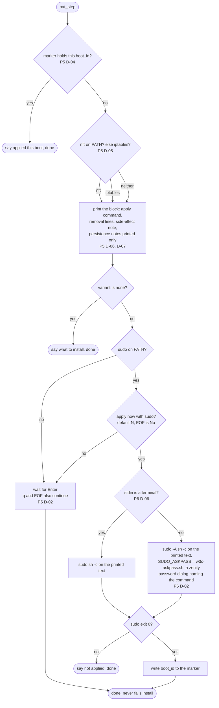
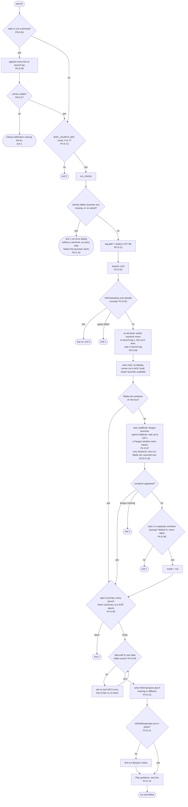
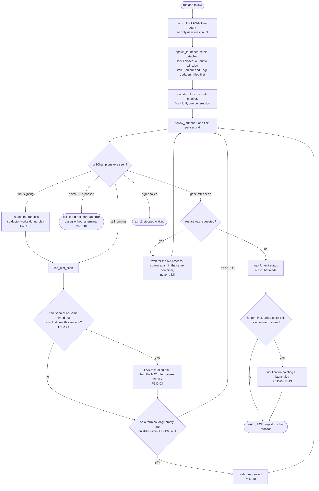
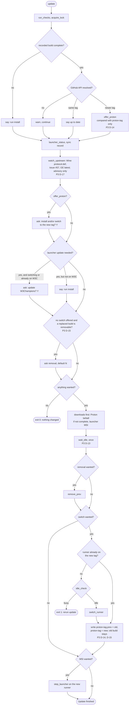
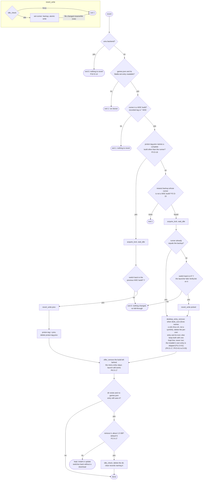
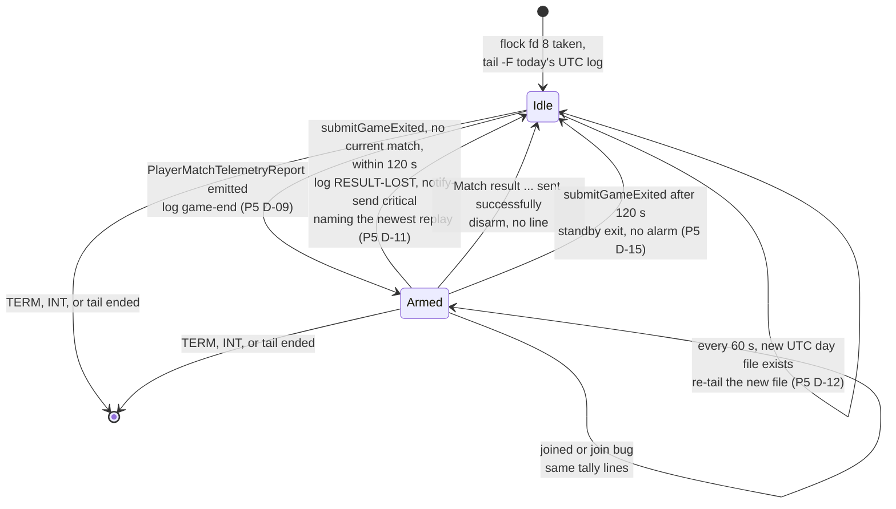

# Architecture

Flow charts of what `w3c-linux.sh` does and where it decides. Every decision node carries its planning ID, written as
`P<phase> D-<n>`. The diagrams are Mermaid, so GitHub, GitLab and most
editors render them inline; nothing needs to be installed.

Each chart stays small on purpose. Error exits that only print a message and return are drawn as one `stop` node, and
the shared helpers (`run_checks`, `wait_idle`, `ask`) are drawn as single boxes. Read the lib file for the details.

## Module map

`packaging/PKGBUILD` runs `make install DESTDIR=... PREFIX=/usr`. The Makefile installs the clone layout under `<prefix>/lib/w3c-linux`
with `<prefix>/bin/w3c-linux` as a relative symlink (`make install-user` uses `~/.local`), so the same rule finds `lib/`.

State on disk, all under `~/.local/state/w3c-linux/`:

| File | Written by | Read by |
|---|---|---|
| `proton-tag` | install, update, revert | install, update, revert, doctor, launch |
| `proton-tag.prev` | update (P3 D-14), cleared by revert | revert, install and update removal offers |
| `launcher-version` | install, update (sync) | doctor, launch |
| `nat-applied` | NAT apply (P5 D-04) | install prompt 8, launch LAN hint |
| `matches.log` | monitor (P5 D-13) | you |
| `monitor.lock` | monitor (flock fd 8) | monitor |
| `*.json` backups | every runner switch (P2 D-18) | revert |

One file lives outside it: `~/.config/w3c-linux/backend` (`$XDG_CONFIG_HOME` is honoured), the umu backend's prefix and runner. `backend set`, `install` and `update` write it (P10 D-13, D-17); every command reads it through `backend_resolve`, and `backend clear` removes it.

## `install`: the questions

Everything is asked first, then the run is unattended (P3 D-01).

```mermaid
flowchart TD
    A([install]) --> B{"W3C_WEBVIEW_WINVER<br/>unset, win7 or win8?<br/>P3 D-07"}
    B -- no --> X1([exit 2])
    B -- yes --> C["run_checks"]
    C --> D{any check failed?}
    D -- yes --> X2([exit 1: run doctor])
    D -- no --> E{"prompt 1: Found Faugus<br/>Battle.net, continue? Y"}
    E -- no --> X3([exit 0: nothing changed])
    E -- yes --> F["acquire_lock"]
    F --> G{"recorded proton-tag names<br/>a complete build?"}
    G -- yes --> H["tag = recorded<br/>API only feeds a newer-tag notice<br/>P2 D-11, D-12"]
    G -- no --> I{"GitHub releases API<br/>resolved? PRT-02"}
    I -- no --> X4([exit 1])
    I -- yes --> J{"build already complete?<br/>P2 D-08"}
    J -- no --> K{"prompt 3: download<br/>tag (size)? Y"}
    K -- no --> X3
    K -- yes --> L["fetch, verify sha256,<br/>extract to staging, place<br/>P2 D-06, D-09"]
    J -- yes --> M
    L --> M["write proton-tag<br/>P2 D-10"]
    H --> N
    M --> N["launcher_status: one GET<br/>of latest.json"]
    N --> O{"runner already<br/>equals tag?"}
    O -- yes --> P["pass: no backup, no switch<br/>P2 D-14"]
    O -- no --> Q{"prompt 4: switch runner? Y"}
    Q -- no --> X5([exit 0: prefix steps not offered])
    Q -- yes --> R["want_switch"]
    P --> S
    R --> S{"WebView2 exe anywhere<br/>in the prefix? P3 D-08"}
    S -- no --> S1["prompt 5: install WebView2? Y"]
    S -- yes --> T
    S1 --> T{"all 3 registry items hold?<br/>P3 D-05"}
    T -- no --> T1["prompt 6: apply registry tweaks? Y"]
    T -- yes --> U
    T1 --> U{"launcher missing<br/>or outdated?"}
    U -- yes --> U1["prompt 7: install or update<br/>W3Champions? Y"]
    U -- no --> V
    U1 --> V{"a replaced build is<br/>removable? P3 D-15"}
    V -- yes --> V1["ask removal, default N"]
    V -- no --> W
    V1 --> W([unattended run])
```

## `install`: the unattended run

```mermaid
flowchart TD
    A([wants from the questions]) --> B{anything wanted?}
    B -- no --> F
    B -- yes --> C["download installers first,<br/>while Faugus may still run<br/>P3 D-02"]
    C --> D["wait_idle: prompt 2<br/>names what runs, waits for Enter,<br/>no retry cap, never kills<br/>P2 D-02, D-03, D-04"]
    D --> D1{removal wanted?}
    D1 -- yes --> D2["remove_prev: idle re-check,<br/>delete the replaced build"]
    D1 -- no --> E
    D2 --> E{switch wanted?}
    E -- yes --> E1{"idle_check again"}
    E1 -- busy --> X1([exit 1: rerun install])
    E1 -- idle --> E2["switch_runner: backup,<br/>atomic games.json write<br/>P2 D-20"]
    E -- no --> G
    E2 --> G["step_webview2 if wanted<br/>step_registry if wanted<br/>step_launcher if wanted<br/>each runs only through umu-run on the W3C build"]
    G --> H{"a step failed?<br/>P3 D-04"}
    H -- yes --> X2(["exit 1: finished steps are<br/>skipped on the rerun"])
    H -- no --> F["install_summary"]
    F --> I{anything still missing?}
    I -- yes --> X3([list it, exit 0])
    I -- no --> J["prompt 8: NAT block<br/>see the NAT chart<br/>P5 D-01"]
    J --> K["prompt 9: firewall ports and<br/>NTP hint, unprivileged reads only<br/>P5 D-08"]
    K --> KS{"installer's entry next to the install prefix?<br/>P11 D-01 (was P7 D-09)"}
    KS -- yes --> KY["no user entry; remove a clone-written one<br/>(P7 D-10); the installer's entry is never<br/>touched (P11 D-01)"]
    KS -- no --> K1["desktop entry and shipped icon copied: written without<br/>a prompt, atomically, only when complete<br/>P6 D-16"]
    KY --> L{"prompt 10: launch now? Y<br/>EOF counts as No"}
    K1 --> L
    L -- no --> X4([exit 0])
    L -- yes --> M([cmd_launch, same run lock])
```

## NAT offer

Shared by install prompt 8 and the launch LAN hint. It never checks the rule itself and sudo runs only here, with exactly
the printed text: in the foreground on a terminal, through `sudo -A` and the askpass dialog without one (P6 D-02).

## `launch`: preflight

## `launch`: run and follow

## `update`

## `revert`

## `monitor`

A tail of the launcher's daily log, forked by `launch` or run standalone. Silent on stdout; outputs are `matches.log`
and `notify-send` (P5 D-14). Log lines are untrusted and are only matched against fixed substrings.

## `doctor` and `report`

Both are read-only. `doctor` runs the shared `run_checks` rows, then the W3C build rows (P2 D-13) and the prefix rows
(P3 D-12), then one `desktop entry` row (pass, absent, or pointing at a missing script; P6 D-17); the row can also read `(system)` for the packaged entry, `(user install)` for the one `make install-user` wrote (P11 D-01), or warn that a user file hides the system entry (P7 D-11). The `version` row comes first (P7 D-07), then `install location` (P11 D-07) and, with two installs, `other install` (P11 D-08). Only the shared rows can fail, so its exit status means "install can run". It makes one GET of `latest.json`
and nothing else (P3 D-10). `report` makes no network call and prints Markdown for a bug report. Neither warrants a chart.
